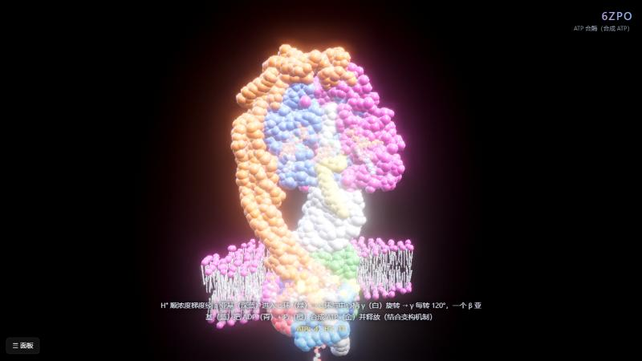

# 分子光影查看器 · Molecule Glow Viewer

实时、可从任意角度旋转的蛋白质 / 分子机器 3D 查看器，风格类似科普视频里的分子动画：黑背景、饱和配色、柔和辉光、剖开的脂双层膜、转动的转子，以及能看到的小分子相互作用。
**一个 HTML 文件**，不需要安装，任何 PDB 编号都直接从 [RCSB PDB](https://www.rcsb.org) 实时下载。

A single-file, real-time Three.js viewer for proteins, molecular machines and their small molecules, with interaction animations and a teaching mode. Structures are downloaded live from the RCSB PDB.



## 功能
- **三种显示模式**
  - 团块（写实）：每个残基一颗发光团块。
  - 结构示意：α 螺旋、β 折叠箭头、卷曲细管。二级结构取自作者沉积的 PDB 注释（`_struct_conf` / `_struct_sheet_range`）。
  - 简化示意（每个部件可单独勾选）：按期刊示意图的画法——环状寡聚体画成鼓，长螺旋画成弯管，球状亚基 / 结构域画成由真实坐标拟合的叶片，DNA 画成轴线管；另有低分辨率分子表面和插画画风（浅底平涂 + 描边）；带部件标注和点击讲解。
- **相互作用动画**
  - ATP 合酶（6ZPO）：H⁺ 驱动 c 环转动；三条 β 链按真实构象依次经历开放 → 松弛 → 紧密；ATP/ADP/Pi/Mg²⁺ 的位置取自晶体结构，并随口袋开合移动（Boyer 结合变构机制）。
  - 鞭毛马达：H⁺ 经定子驱动转子。
  - KcsA 钾通道：K⁺ 通过选择性过滤器。
  - 腺苷酸激酶：在两个构象之间开合。
- **小分子**：用化学组分字典（CCD）的理想构型画成真实的球棍模型。
- **剖开与膜**：剖开的楔形固定在模型上，旋转时结构不会闪烁或消失；脂双层可剖开。
- **本地文件**：可拖入 .cif/.pdb（AlphaFold、自建模型）。
- **自动画质**：按显卡自动选择画质，没有独立显卡也能运行。

## 使用
双击 `index.html`（Chrome / Edge 最新版）。若浏览器拦截本地文件的网络请求：
```bash
python -m http.server 8765
```
然后打开 `http://localhost:8765/index.html`。网址参数：`?pdb=4HHB`、`?preset=鞭毛马达`、`&q=low|medium|high`。

需要能访问 `models.rcsb.org`、`data.rcsb.org`、`files.rcsb.org`、`cdn.jsdelivr.net`。

## 给 AI 的 skill
`skill/` 是一个 Claude Code skill（`SKILL.md` + `references/`），说明如何添加预设、编写过程动画、从论文做动画、从零重建，以及如何调试。
复制到 `~/.claude/skills/molecule-glow-viewer/` 即可使用。

## 数据来源与引用
所有结构数据来自 RCSB PDB，使用时请引用 PDB 以及各结构的原始论文：
- Berman, H. M. et al. (2000) The Protein Data Bank. *Nucleic Acids Res.* 28, 235–242.
- Burley, S. K. et al. (2023) RCSB Protein Data Bank (RCSB.org). *Nucleic Acids Res.* 51, D488–D508.

预设中使用的条目（原始论文以各条目 RCSB 页面上的 Primary Citation 为准）：

| 预设 | PDB | 原始论文 |
|---|---|---|
| ATP 合酶 | 6ZPO | Spikes, Montgomery & Walker (2020) *PNAS* 117, 23519 |
| 鞭毛马达 | 7CGO | Tan et al. (2021) *Cell* 184, 2665 |
| 鞭毛马达 C 环 | 8YJT | Tan, Zhang, Zhou et al. (2024) *Cell Res.* 34, 788 |
| 鞭毛马达定子 | 6YKM | Santiveri et al. (2020) *Cell* 183, 244 |
| 鞭毛丝 | 1UCU | Yonekura, Maki-Yonekura & Namba (2003) *Nature* 424, 643 |
| 钾通道 KcsA | 1BL8 | Doyle et al. (1998) *Science* 280, 69 |
| 腺苷酸激酶 | 4AKE / 1AKE | Müller et al. (1996) *Structure* 4, 147；Müller & Schulz (1992) *J. Mol. Biol.* 224, 159 |
| GroEL–GroES | 1AON | Xu, Horwich & Sigler (1997) *Nature* 388, 741 |
| 核糖体 | 4YBB | Noeske et al. (2015) *Nat. Struct. Mol. Biol.* 22, 336 |
| 核小体 | 1KX5 | Davey et al. (2002) *J. Mol. Biol.* 319, 1097 |
| 蛋白酶体 | 5LE5 | Schrader et al. (2016) *Science* 353, 594 |
| HK97 衣壳 | 2FT1 | Gan et al. (2006) *Structure* 14, 1655 |

机制参考：
- Boyer, P. D. (1997) The ATP synthase — a splendid molecular machine. *Annu. Rev. Biochem.* 66, 717.
- Abrahams, J. P. et al. (1994) Structure at 2.8 Å resolution of F1-ATPase from bovine heart mitochondria. *Nature* 370, 621.

动画中的时序、粒子路径和小分子放大比例是**示意**，用于教学，不代表定量动力学。

## 技术
[Three.js](https://threejs.org) r160（MIT），通过 jsDelivr 加载。所有几何体都在浏览器中实时生成，仓库内不含结构数据。

## 许可证
MIT，见 [LICENSE](LICENSE)。PDB 数据本身属于公共领域（CC0），但仍请按上文引用。
