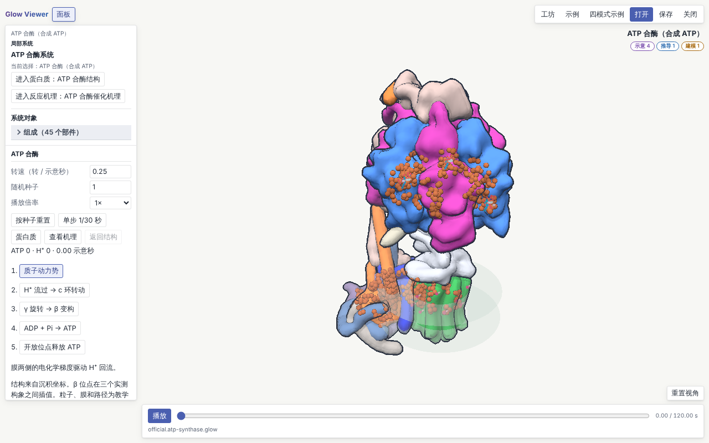
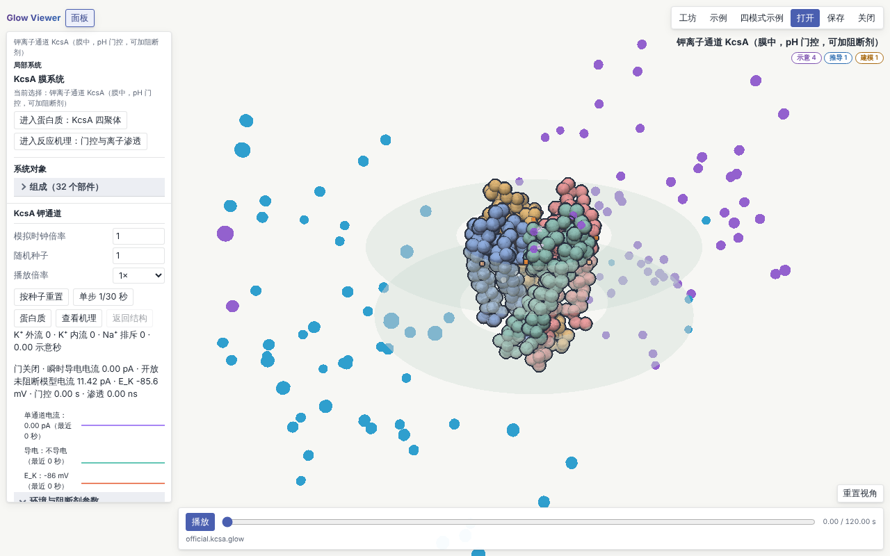
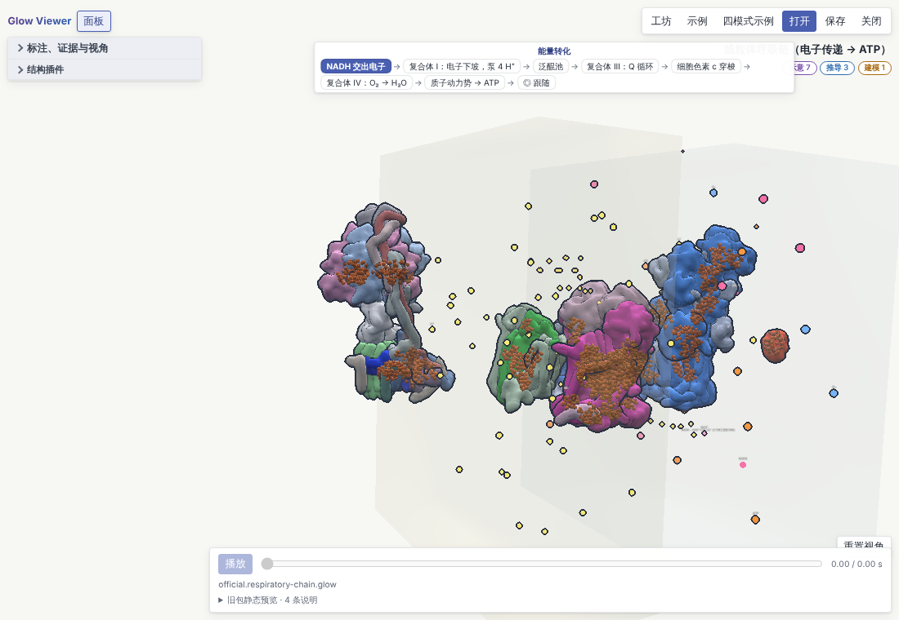
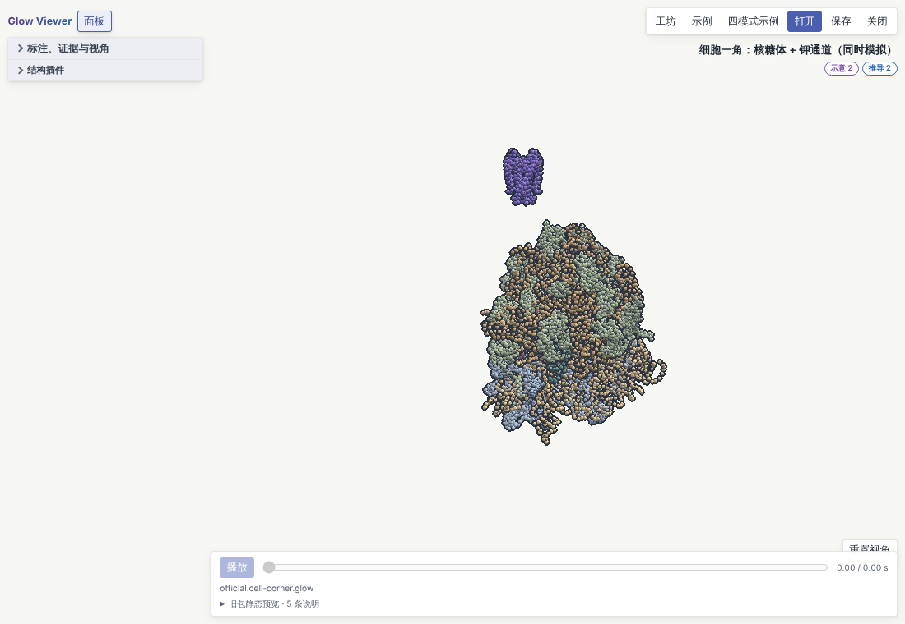
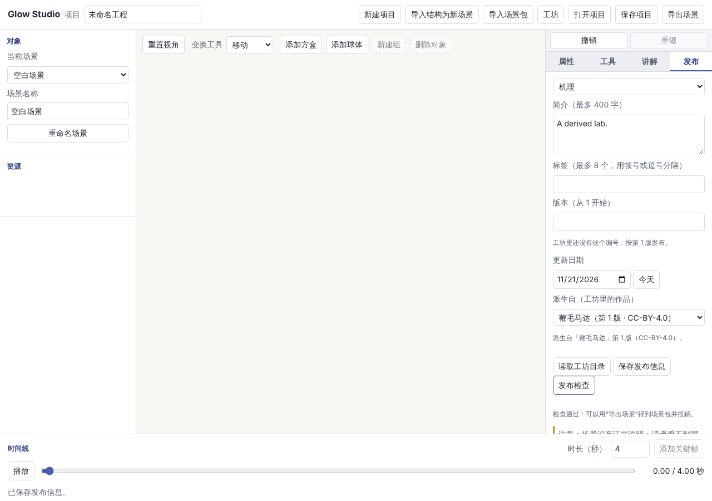
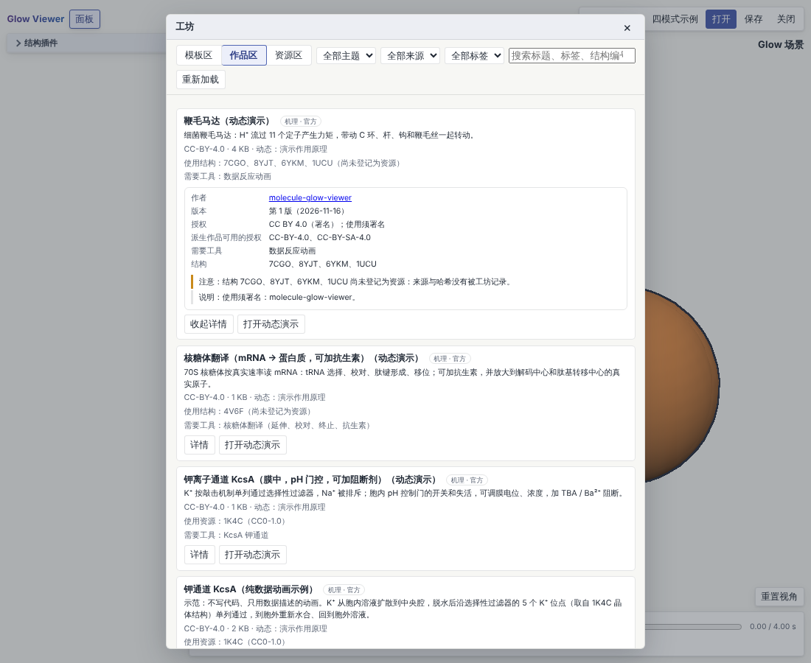

# 分子光影查看器 · Molecule Glow Viewer

从真实分子结构出发，做**可交互的教学场景**：看结构、读解说，也能让 ATP 合酶转起来、让钾通道开合、让呼吸链一步步传电子，最后放大到细胞的一角。基于 Three.js，在浏览器和 Windows 桌面版里运行。

> 上图是新版 Viewer 打开官方“ATP 合酶”作品（真实结构 6ZPO）：左侧是系统导航、转速与种子、五步机理讲解，中间是结构与示意粒子，底部是时间轴。

## 下载

**Desktop v0.8.0**（Windows 便携版，免安装，未签名——首次运行如被 SmartScreen 拦截，选择“仍要运行”）：

- [MoleculeGlow-0.8.0-win-x64.exe](https://github.com/Nimenta727/molecule-glow-viewer/releases/download/desktop-v0.8.0/MoleculeGlow-0.8.0-win-x64.exe)
- [发行说明与校验文件](https://github.com/Nimenta727/molecule-glow-viewer/releases/tag/desktop-v0.8.0) · [制作 Skill ZIP](https://github.com/Nimenta727/molecule-glow-viewer/releases/download/desktop-v0.8.0/molecule-glow-viewer-skill-0.7.0.zip)
- 旧版：[v0.6.0](https://github.com/Nimenta727/molecule-glow-viewer/releases/tag/desktop-v0.6.0)、[v0.5.0](https://github.com/Nimenta727/molecule-glow-viewer/releases/tag/desktop-v0.5.0)

默认打开经典 Viewer；在“工作区”菜单里切换到新版 Viewer、Studio 和开发者工作台。在线体验经典版：[nimenta727.github.io/molecule-glow-viewer](https://nimenta727.github.io/molecule-glow-viewer/)。

## 能做什么

| | |
|---|---|
|  | **钾通道 KcsA**：胞内 pH 控制门的开关，K⁺ 按选择性过滤器的位点一个个通过，可以改膜电位、两侧浓度，加 TBA 或 Ba²⁺ 阻断，看电流、导通和 E_K 曲线。 |
|  | **线粒体呼吸链**：顶部的能量转化条一步步点亮（NADH → 复合体 I → 泛醌 → 复合体 III → 细胞色素 c → 复合体 IV → ATP 合酶），结构周围的半透明体积是各区室的 pH，计数和曲线随动力学模型走。 |
|  | **细胞一角**：核糖体和膜里的钾通道放在同一个场景里，各有自己的时钟、控制和计数；通道按经典规则摆在核糖体切面内、膜下方。 |

另外还有：鞭毛马达（可调驱动梯度，CheY-P 换向）、叶绿体光反应、翻译（延伸、校对、抗生素）、整个大肠杆菌细胞、腺苷酸激酶的开合等。官方包分**模板**（完全静态，只看结构、读解说）和**作品**（动态，演示作用原理）两类。

## 自己做一个

新版 Studio 把“导入结构 → 加工具 → 写讲解和证据 → 发布”接成一条线：

- **导入**蛋白质等结构（PDB / mmCIF，或从 RCSB、工坊资源取回），放进多场景工程，编辑对象、关键帧、讲解、证据和视角书签。
- **工具**按描述符自动生成面板：溶液粒子、数据反应动画、随机状态过程、核糖体翻译、多过程组合。
- **发布**：填写作者、授权、主题、版本，可以从工坊里的作品“派生”（授权会按来源自动收窄）。“发布检查”列出问题、注意和说明，工坊的校验脚本跑的是同一套规则。
- **草稿恢复**：编辑时自动在本地留草稿，意外关闭后下次打开可以恢复。

工坊里每个条目都能展开看作者、版本、授权条款、派生关系、所需工具和依赖诊断。社区作品只含数据，不执行包内脚本。

用脚本或 AI 控制 Viewer：`window.glow` 提供 `load`、`select`（完整选择语言）、`color`、`measure`、`sequence`、`clip`、`camera`、`animate`、`exportPack` 等命令，`glow.help()` 会列出命令和已注册的工具。详见 [命令接口](docs/VIEWER_COMMAND_API.md) 与 [制作 Skill](skill/README.md)。

## 入口

| 入口 | 用途 |
|---|---|
| [经典在线版](https://nimenta727.github.io/molecule-glow-viewer/) / [web/index.html](web/index.html) | 完整的经典科学体验，也是对照与回退入口 |
| Windows EXE | 默认经典 Viewer；菜单进入新 Viewer、Studio 和开发者工作台；Three.js 随包，缓存或包内的结构可离线使用 |
| [新版 Viewer](apps/viewer-web/) | 迁移目标：结构、选择语言、序列条、测量、剖切、五种表示、保存重开，以及 ATP / KcsA / AdK 播放器和五个通用工具 |
| [Studio](apps/studio-web/) | 制作与发布 |
| [工坊](workshop/) / [制作 Skill](skill/README.md) | 资源区与作品区；为 AI/作者提供制作指导 |

从源码运行：`npm ci`，在仓库根目录执行 `python -m http.server 8765`，打开 `http://localhost:8765/apps/viewer-web/`（Studio 在 `/apps/studio-web/`）；桌面版构建见 [desktop/README.md](desktop/README.md)。

## 项目是什么、做到哪里

项目正在把经典 Viewer 的科学功能迁入 **Core 主体＋官方插件**：插件提供功能（粒子、数据反应、门控、翻译、测量、分析……），蛋白质是资源，线粒体、呼吸链等是作品，不为每个作品写专用插件。经典入口保留。

- 已完成：制作基底（4.3）、经典功能的插件化（4.4 的代码层面：结构、构象、粒子、数据反应、门控、翻译、环境与多过程、分析与教学工具，及 ATP 合酶、KcsA、AdK、呼吸链、叶绿体、鞭毛、翻译、细胞的作品迁移）、作者/接口/工坊闭环（4.5）。
- **边界要说清**：新版还不等于经典版的完整科学与视觉等价（功能清单里每一项仍标“部分完成”或“仅预览”，需要截图证据和署名的科学审阅人才能标成完成）；粒子、膜、时间标尺是教学示意，确定性不等于实验有效性；没有在真实 GPU 上验证过性能与外观（EXE 由 CI 在软件渲染下实际启动并通过回归）。
- 还没做：`style`（画风）命令、按残基范围上色、整细胞的区域层级内容、官方作品里部分结构登记为资源。

详细、逐项的状态见 [项目现状](docs/STATUS.md) 和 [功能契约](docs/feature-parity.json)。

## 文档与开发

[文档首页](docs/README.md) · [项目现状](docs/STATUS.md) · [现有功能](docs/CURRENT_FEATURES.md) · [项目结构](docs/ARCHITECTURE.md) · [后续计划](docs/ROADMAP.md) · [发布验证](docs/RELEASE_VALIDATION.md) · [命令接口](docs/VIEWER_COMMAND_API.md) · [工坊格式](workshop/SCHEMA.md) · [每次修改的记录](docs/routine/)

检查：`npm test`、`node tools/check-feature-parity.mjs`、`node tools/build.mjs --check`、`node tools/check-copies.mjs`、`node workshop/tools/validate.mjs`。真实浏览器检查（需要 Playwright）：`node tools/studio-authoring-check.cjs`（发布与草稿恢复）、`node tools/viewer-stability-check.cjs`（重复加载稳定性）、`node tools/work-shot.cjs <作品编号>`（打开一个作品并截图）。

经典 `src/` 构建到 web、桌面与 Skill；新功能使用 `apps/`、`packages/`、`plugins/`。保留经典基线，不以静态预览、孤立关键帧或代码行数宣布迁移完成。

许可见 [LICENSE](LICENSE) 与 [NOTICE](NOTICE)。
